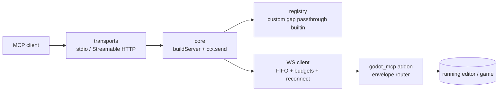
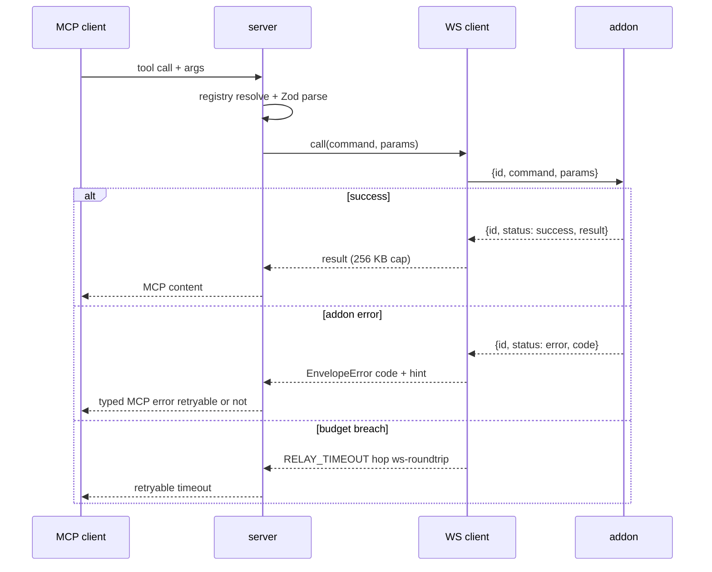
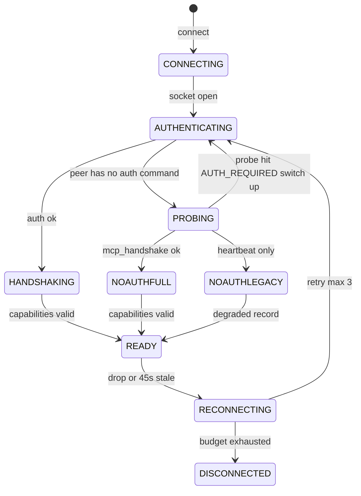

# godot-mcp-server

Game-agnostic TypeScript MCP server bridging MCP clients (Claude Code,
Claude Desktop, Cursor, cloud) and a running Godot editor.

It maps MCP tools onto the `godot_mcp` addon `{id,command,params}` /
`{status,result,error}` envelope, closes the authoring gaps (node lifecycle,
signal connect/disconnect, 3D viewport, import/UID helpers, ClassDB
introspection), and exposes a plugin API so per-project tools stay
project-side.

> Status: v0.1.0. Protocol baseline pinned against addon `4.1.11` and
> Godot `4.7.2`. See [CHANGELOG.md](./CHANGELOG.md).

[](./CHANGELOG.md)
[](./package.json)
[](./CHANGELOG.md)
[](./LICENSE)

## Table of contents

1. [What is this?](#1-what-is-this)
2. [Quickstart](#2-quickstart)
3. [Architecture](#3-architecture)
4. [Tool-call flow](#4-tool-call-flow)
5. [Handshake, auth, and negotiation](#5-handshake-auth-and-negotiation)
6. [Tool inventory](#6-tool-inventory)
7. [Manipulable-node matrix](#7-manipulable-node-matrix)
8. [Plugin API](#8-plugin-api)
9. [Configuration, budgets, limits, and non-goals](#9-configuration-budgets-limits-and-non-goals)
10. [Development](#10-development)

## 1. What is this?

`godot-mcp-server` is a single-client bridge: one MCP client talks to one
running Godot editor over a WebSocket owned by the `godot_mcp` addon.
The server speaks MCP on one side (stdio or Streamable HTTP) and the addon
JSON envelope on the other. It never touches the scene directly; every
editor effect goes through an addon command frame.

Three tool strata, inventoried from code
(`src/tools/**/*.ts` + `src/server/toolRegistry.ts`):

| Stratum | Count | What |
|---|---|---|
| `builtin` | 1 | Local-only `server_status` (no addon traffic) |
| `passthrough` | 84 | Verbatim re-exposure of addon `4.1.11` command sets |
| `gap` | 16 | New-surface tools closing authoring gaps (see compat column) |

Total: **101 tools**. Passthrough tools work against the real addon
`4.1.11`. Gap tools that need **new** addon commands are marked ⏳ below;
they are fixture-covered server-side while the live addon behavior is still
pending on the addon side.

## 2. Quickstart

Requirements:

- Node.js >= 18.
- A running Godot editor (>= 4.5) with the `godot_mcp` addon enabled.
- The `verify` tool additionally needs a Godot binary on `PATH`
  (discovery order: `godot-mcp.godotBinary` config, `GODOT_BINARY` env,
  `PATH` lookup for `godot`, then `godot4`, then well-known locations).

No install needed; run it straight from the registry:

```bash
npx -y godot-mcp-server@0.1.0 --help
```

Or pin it as a project dependency:

```bash
npm install godot-mcp-server@0.1.0
```

### Transports: stdio vs `--http`

`stdio` is the default and fits local clients (Claude Code, Claude Desktop).
`--http` serves Streamable HTTP on loopback for remote clients (Cursor,
cloud). Both entrypoints build the server through the same `buildServer`
factory, so the tool surface is identical.

```bash
# stdio (default)
npx -y godot-mcp-server@0.1.0

# Streamable HTTP on 127.0.0.1:3000
npx -y godot-mcp-server@0.1.0 --http

# HTTP on a custom port (flag > GODOT_MCP_HTTP_PORT env > default 3000)
npx -y godot-mcp-server@0.1.0 --http --port 4000
```

### Auth: `--no-auth` and `GODOT_MCP_TOKEN`

Auth-first is the default. The server resolves the token out of band in
this order: `GODOT_MCP_TOKEN` env (canonical), then
`<project>/.godot/mcp-token.json`, then the editor-log scrape fallback
(which warns and tells you to set the env var).

```bash
export GODOT_MCP_TOKEN="<token-from-the-editor>"
npx -y godot-mcp-server@0.1.0
```

`--no-auth` exists ONLY for vanilla addons that do not speak auth: it
probes the peer and negotiates a visible no-auth mode instead of failing
silently. Do not use it against auth-capable addons; a probe that hits
`AUTH_REQUIRED` switches back up to auth (never a silent downgrade).

```bash
npx -y godot-mcp-server@0.1.0 --no-auth
```

### Register with your client (pinned)

Claude Code:

```bash
claude mcp add godot-mcp-server -- npx -y godot-mcp-server@0.1.0
```

JSON equivalent (Claude Desktop / Cursor `mcp.json`):

```json
{
  "mcpServers": {
    "godot-mcp-server": {
      "command": "npx",
      "args": ["-y", "godot-mcp-server@0.1.0"],
      "env": {
        "GODOT_MCP_TOKEN": "<token-from-the-editor>"
      }
    }
  }
}
```

## 3. Architecture

Layered, one direction per hop. Transports share the `buildServer` factory;
the WS client owns correlation state, FIFO multiplex, timers, and reconnect;
the registry resolves `custom > gap > passthrough > builtin`; the addon owns
the editor.



Sources: `src/transports/stdio.ts`, `src/transports/http.ts`,
`src/server/buildServer.ts`, `src/server/toolRegistry.ts`,
`src/godot/wsClient.ts`, `src/godot/envelope.ts`.

## 4. Tool-call flow

One frame in flight (FIFO). Budgets, caps, and typed errors apply per hop;
check-level failures are coded entries, never null-with-success.



Error policy (`src/godot/mcpErrors.ts`): `UNKNOWN_COMMAND` carries
Levenshtein `did you mean` hints; `ALREADY_CONNECTED` (bridge held by
another client, WS close `4001`) is retryable with a backoff/handoff hint
and never triggers reconnect; `RELAY_TIMEOUT` carries `hop` + `budget_ms`;
`PAYLOAD_TOO_LARGE` fires client-side above 16 MB before touching the
socket; oversize results truncate explicitly at 256 KB, never silently.

## 5. Handshake, auth, and negotiation

Default path is auth-first: `auth` (with one retry on `AUTH_FAILED`) then
`mcp_handshake` carrying `server_version: "godot-mcp-server/<semver>"`.
`--no-auth` probes `mcp_handshake` then `heartbeat`; legacy peers that only
answer `heartbeat` land in a degraded `no-auth-legacy` record. Every
negotiation emits one normative mode line:

```text
godot-mcp-server: negotiated mode=<auth|no-auth-full|no-auth-legacy> addon=<v> godot=<v>
```



Capability record (`src/godot/capabilities.ts`): all five fields
(`addon_version`, `godot_version`, `project_path`, `project_name`,
`server_version_received`) are REQUIRED; a missing field is loud
`INVALID_FORMAT`. The pin check (addon SHOULD equal `4.1.11`, Godot SHOULD
be >= 4.5) warns and sets `protocol_drift_suspected` without aborting.
`server_status` is the assertion surface for the negotiated mode alongside
the log line.

## 6. Tool inventory

Conventions for every table below:

- **Addon command**: the exact `command` string sent in the envelope frame.
  For passthrough tools it equals the tool name (verbatim re-exposure).
- **Mutating**: `YES` means the call changes editor/scene state.
- **Undo**: the named `EditorUndoRedo` action, `addon` when the addon's own
  undo action applies, `exempt` for the explicit v0.1.0 exemption (writes
  with `mutating: true, undoAction: null`), `N/A` otherwise.
- **Compat**: ✅ works with the real addon `4.1.11`; ⏳ requires NEW addon
  commands not yet implemented (fixture-covered, live behavior pending);
  🔌 local-only, no addon traffic.

### 6.1 builtin (1)

| Tool | What | Addon command | Mutating / Undo | Compat |
|---|---|---|---|---|
| `server_status` | Reports negotiated mode + capability record | — (local) | NO / N/A | 🔌 local |

### 6.2 gap — node lifecycle (4, `src/tools/nodes.ts`)

| Tool | What | Addon command | Mutating / Undo | Compat |
|---|---|---|---|---|
| `create_node` | Instantiates a class under a parent path, owner wired to scene | `create_node` | YES / `Create <Class> <name>` | ⏳ new surface |
| `instantiate_scene` | Instantiates a scene file under a parent path | `instantiate_scene` | YES / `Instantiate <scene_file>` | ⏳ new surface |
| `duplicate_node` | Duplicates a node, optional new name | `duplicate_node` | YES / `Duplicate <name>` | ⏳ new surface |
| `delete_node` | Deletes a node; `confirm_name` must equal the leaf name (Zod-enforced accident guard) | `delete_node` | YES / `Delete <name>` | ⏳ new surface |

### 6.3 gap — ClassDB introspection (3, `src/tools/introspection.ts`)

Read-only. Unknown classes return `result.found=false`, never an exception.

| Tool | What | Addon command | Mutating / Undo | Compat |
|---|---|---|---|---|
| `class_list` | Lists ClassDB classes, optional search/parent filter, limit default 200 | `class_list` | NO / N/A | ⏳ new surface |
| `class_describe` | Describes one ClassDB class, brief/full (default brief) | `class_describe` | NO / N/A | ⏳ new surface |
| `signals_of` | Lists one class's signals with argument names | `signals_of` | NO / N/A | ⏳ new surface |

### 6.4 gap — signals (3, `src/tools/signals.ts`)

| Tool | What | Addon command | Mutating / Undo | Compat |
|---|---|---|---|---|
| `connect_signal` | Connects a node signal to a target method (+binds) | `connect_signal` | YES / `Connect <signal> → <method>` | ⏳ new surface |
| `disconnect_signal` | Disconnects a node signal from a target method | `disconnect_signal` | YES / `Disconnect <signal> → <method>` | ⏳ new surface |
| `trace_signal` | Traces one signal for `duration_s` (default 10, max 300) via watch stream, auto-stops; extended 60 s budget; the only tool allowed multi-command composition (`watch_start` + `watch_collect` + `watch_stop`) | `watch_start`/`watch_collect`/`watch_stop` | NO / N/A | ⏳ new surface |

### 6.5 gap — 3D viewport (2, `src/tools/viewport.ts`)

Navigation only, non-mutating by rule.

| Tool | What | Addon command | Mutating / Undo | Compat |
|---|---|---|---|---|
| `set_3d_viewport` | Moves the 3D editor camera (position + rotation, optional distance/focus) | `set_3d_viewport` | NO / N/A | ⏳ new surface |
| `focus_selection` | Frames 1–64 nodes in the editor viewport | `focus_selection` | NO / N/A | ⏳ new surface |

### 6.6 gap — assets (3, `src/tools/assets.ts`)

Filesystem side effects, so UndoRedo is N/A. `import_asset` is idempotent
when `reimport=false`. All paths go through the scoped-path guard.

| Tool | What | Addon command | Mutating / Undo | Compat |
|---|---|---|---|---|
| `import_asset` | Scans or reimports an asset | `import_asset` | FS side effect / N/A | ⏳ new surface |
| `uid_resolve` | Resolves a `uid://` identifier to its `res://` path (null when unknown) | `uid_resolve` | NO / N/A | ⏳ new surface |
| `list_assets` | Lists project assets matching a glob, paginated (limit default 200) | `list_assets` | NO / N/A | ⏳ new surface |

### 6.7 gap — verify (1, `src/tools/verify.ts`)

Server-side headless-Godot checks for the repo TDD loop. No addon traffic.

| Tool | What | Addon command | Mutating / Undo | Compat |
|---|---|---|---|---|
| `verify` | Runs `import` + `check-only` (defaults), optional `playtest-smoke` (`--quit-after 60`); returns `{checks: [{name, ok, output_tail}], ok}`; extended 60 s budget | — (subprocess) | NO / N/A | 🔌 local (needs Godot binary, gate >= 4.5, drift warn above baseline 4.7.2) |

### 6.8 passthrough — scene (4) ✅ `4.1.11`

| Tool | What | Mutating / Undo |
|---|---|---|
| `get_scene_tree` | Reads the edited scene tree (optional depth/children trims) | NO / N/A |
| `open_scene` | Opens a scene file in the editor | NO / N/A |
| `save_scene` | Saves the active scene (optional path for save-as) | YES / addon |
| `reload_scene` | Reloads an open scene from disk; disk wins over unsaved edits | YES / addon |

### 6.9 passthrough — node edit (4) ✅ `4.1.11`

| Tool | What | Mutating / Undo |
|---|---|---|
| `get_node_properties` | Reads the editor-visible properties of one node | NO / N/A |
| `find_nodes` | Searches the edited scene by name pattern and/or class (at least one required, Zod-enforced) | NO / N/A |
| `update_node` | Sets node properties | YES / addon (`MCP update_node …`) |
| `reparent_node` | Moves a node to a new parent | YES / addon (`MCP reparent_node …`) |

### 6.10 passthrough — selection + 2D viewport (4) ✅ `4.1.11`

| Tool | What | Mutating / Undo |
|---|---|---|
| `get_editor_state` | Reads editor state (current scene, play mode, open scenes, viewport) | NO / N/A |
| `get_selected_nodes` | Lists the currently selected nodes | NO / N/A |
| `select_node` | Clears the selection and selects one node | NO / N/A |
| `set_2d_viewport` | Moves the 2D editor viewport (navigation; omitted fields keep current view) | NO / N/A |

### 6.11 passthrough — animation (16) ✅ `4.1.11`

Reads: `list_animation_players`, `get_animation_player_info`,
`get_animation_details`, `get_track_keyframes`. Game-driving (stay reads):
`play_animation`, `stop_animation`, `seek_animation`. Writes below are
explicitly exempt from undo in v0.1.0.

| Tool | What | Mutating / Undo |
|---|---|---|
| `create_animation` | Creates an animation | YES / exempt |
| `delete_animation` | Deletes an animation | YES / exempt |
| `update_animation_properties` | Updates animation properties | YES / exempt |
| `add_animation_track` | Adds an animation track | YES / exempt |
| `remove_animation_track` | Removes an animation track | YES / exempt |
| `add_keyframe` | Adds a keyframe | YES / exempt |
| `create_reset_keys` | Creates reset keys | YES / exempt |
| `remove_keyframe` | Removes a keyframe | YES / exempt |
| `update_keyframe` | Updates a keyframe | YES / exempt |

### 6.12 passthrough — tiles (21: 11 TileMapLayer + 10 GridMap/MeshLibrary) ✅ `4.1.11`

Reads: `list_tilemap_layers`, `get_tilemap_layer_info`, `get_tileset_info`,
`get_used_cells`, `get_cell`, `get_cells_in_region`, `convert_coords`
(either/or rule Zod-enforced), `list_gridmaps`, `get_gridmap_info`,
`get_meshlib_info`, `get_gridmap_used_cells`, `get_gridmap_cell`,
`get_cells_by_item`. Writes below are explicitly exempt from undo in v0.1.0.

| Tool | What | Mutating / Undo |
|---|---|---|
| `set_cell` | Writes one TileMapLayer cell | YES / exempt |
| `erase_cell` | Erases one TileMapLayer cell | YES / exempt |
| `clear_layer` | Clears every cell of a TileMapLayer | YES / exempt |
| `set_cells_batch` | Writes many TileMapLayer cells in one call | YES / exempt |
| `set_gridmap_cell` | Writes one GridMap cell item | YES / exempt |
| `clear_gridmap_cell` | Clears one GridMap cell | YES / exempt |
| `clear_gridmap` | Clears every cell of a GridMap | YES / exempt |
| `set_gridmap_cells_batch` | Writes many GridMap cells in one call | YES / exempt |

### 6.13 passthrough — debug (4) ✅ `4.1.11`

| Tool | What | Mutating / Undo |
|---|---|---|
| `run_project` | Runs the project in the editor (optional scene/frozen launch) | drives game / N/A |
| `stop_project` | Stops the running project | drives game / N/A |
| `get_log_messages` | Reads buffered log messages (clear/limit/severity/since filters) | NO / N/A |
| `get_stack_trace` | Reads the last error and its stack frames | NO / N/A |

### 6.14 passthrough — runtime watch (4) ✅ `4.1.11`

| Tool | What | Mutating / Undo |
|---|---|---|
| `get_runtime_state` | Samples live node state from the running game | NO / N/A |
| `watch_start` | Starts a watch stream (specs/hz/duration/signals) | NO / N/A |
| `watch_collect` | Collects buffered watch samples | NO / N/A |
| `watch_stop` | Stops the active watch stream | NO / N/A |

### 6.15 passthrough — profiler (6) ✅ `4.1.11`

`get_performance_metrics`, `start_profiler`, `stop_profiler`,
`get_profiler_data`, `get_active_processes`, `get_signal_connections`
(optional node filter). All read-only, N/A undo.

### 6.16 passthrough — input (3) ✅ `4.1.11`

| Tool | What | Mutating / Undo |
|---|---|---|
| `get_input_map` | Reads the project input map (live bridge when running, project settings otherwise) | NO / N/A |
| `execute_input_sequence` | Injects a timed input sequence into the running game (extended 60 s budget) | drives game / N/A |
| `type_text` | Types text into the running game (extended 60 s budget) | drives game / N/A |

### 6.17 passthrough — game time (5) ✅ `4.1.11`

`game_time_freeze`, `game_time_step` (duration or frames, one required),
`game_time_step_until` (predicate, optional max/inputs/report),
`game_time_thaw`, `game_time_status`. All drive or read frozen time, N/A undo.

### 6.18 passthrough — screenshots (2) ✅ `4.1.11`

| Tool | What | Mutating / Undo |
|---|---|---|
| `capture_game_screenshot` | Captures the running game viewport (server injects `max_width` 1280 / `png` defaults) | NO / N/A |
| `capture_editor_screenshot` | Captures the active editor viewport (same defaults) | NO / N/A |

### 6.19 passthrough — meshes (1) ✅ `4.1.11`

| Tool | What | Mutating / Undo |
|---|---|---|
| `validate_meshes` | Walks ArrayMesh surfaces for silent corruption (optional `max_findings` cap) | NO / N/A |

### 6.20 passthrough — 3D resources (3) ✅ `4.1.11`

| Tool | What | Mutating / Undo |
|---|---|---|
| `get_resource_info` | Reads resource metadata (required path; optional depth/internal) | NO / N/A |
| `get_spatial_info` | Reads Node3D spatial info (optional children/type/region filters) | NO / N/A |
| `get_scene_bounds` | Computes world-space bounds of the open scene (optional subtree) | NO / N/A |

### 6.21 passthrough — project (3) ✅ `4.1.11`

| Tool | What | Mutating / Undo |
|---|---|---|
| `get_project_info` | Reads project identity (name, path, Godot version, main scene) | NO / N/A |
| `get_project_settings` | Reads project settings, optional category prefix | NO / N/A |
| `get_project_staleness` | Reports whether `project.godot` changed on disk after load | NO / N/A |

### 6.22 passthrough — exec (4) ✅ `4.1.11`

Escape hatch: GDScript eval in the game is synchronous and non-preemptible
by design. Every description carries the fence
`escape hatch, prefer typed tools`. The bridge rejects empty sources with
`NO_CODE`; `exec_list`/`exec_clear` take no params.

| Tool | What | Mutating / Undo |
|---|---|---|
| `exec_run` | Runs GDScript source in the game | drives game / N/A |
| `exec_list` | Lists live exec holder nodes | NO / N/A |
| `exec_remove` | Removes one exec holder node by exact name | drives game / N/A |
| `exec_clear` | Removes every exec holder node | drives game / N/A |

## 7. Manipulable-node matrix

Derived from `src/tools/nodes.ts`, `src/tools/signals.ts`,
`src/tools/introspection.ts`, and the passthrough node/scene/selection sets.

| Class / scope | Read | Write | Notes |
|---|---|---|---|
| Any class via `ClassDB.instantiate` | `class_list`, `class_describe`, `signals_of` | `create_node` (any `class_name`) | Addon branches create at runtime on `is Node3D` / `is CanvasItem` (no 2D/3D split); one undo action per call incl. batch forms |
| 2D nodes (`CanvasItem` branch) | `get_node_properties`, `find_nodes`, `get_scene_tree`, `set_2d_viewport` nav | `update_node`, `reparent_node` (addon undo), `duplicate_node`, `delete_node` (confirm gate) | `update_node`/`reparent_node` work today (✅); lifecycle gap tools pending (⏳) |
| 3D nodes (`Node3D` branch) | `get_spatial_info`, `get_scene_bounds`, `get_resource_info`, `set_3d_viewport`/`focus_selection` nav | Same lifecycle writes as 2D | Viewport tools are navigation-only, never undoable |
| Scene files | `open_scene` target, `get_editor_state` | `instantiate_scene`, `open_scene`, `save_scene`, `reload_scene` (disk wins) | Scene ownership wired via `owner_to_scene` (default true) |
| Signals | `signals_of`, `get_signal_connections`, `trace_signal` | `connect_signal`, `disconnect_signal` (undoable) | ⏳ new addon surface |
| Tiles / GridMaps | All `get_*`/`list_*`/`convert_coords` | `set_*`/`erase_*`/`clear_*` writes | YES mutating, explicitly exempt from undo in v0.1.0 |
| Animations | All `get_*`/`list_*`, `play/stop/seek` | `create/update/delete`, tracks, keyframes | YES mutating, explicitly exempt from undo in v0.1.0 |
| Running-game nodes | `get_runtime_state`, watch streams, `validate_meshes` | `exec_run` (escape hatch), input/time tools | Game-side effects are not editor-undoable |

Read-only everywhere: `find_nodes`, `get_node_properties`,
`get_scene_tree`, `get_editor_state`, `get_selected_nodes`,
`get_spatial_info`, `get_scene_bounds`, `get_runtime_state`,
`get_resource_info`, `validate_meshes`, `get_project_*`.

## 8. Plugin API

Per-project tools stay project-side. List startup plugin module paths under
the `godot-mcp.plugins` client-config key (or `GODOT_MCP_PLUGINS` env,
comma-separated); a watched plugin dir additionally hot-loads at runtime.
A duplicate tool name fails fast with `DUPLICATE_TOOL`, and builtins can
never be unregistered.

```json
{
  "godot-mcp.plugins": ["./tools/godot-mcp/plugins/infinity_mu_tools.js"]
}
```

Minimal plugin module (any of: named `toolDefs` export,
`default.toolDefs`, or the default export itself):

```ts
// my-plugin.js — handlers MUST go through ctx.send only.
export const toolDefs = [
  {
    name: "my_project_greet",
    description: "Greets from the project side.",
    inputSchema: {},
    handler: async (_args, ctx) => ctx.send("get_project_info", {}),
    kind: "custom", // forced to custom whatever the module declares
  },
];
```

Core limits enforced at load time (`src/server/pluginLoader.ts`, each
violation fails with a pointer to the spec):

- No game-content tools in core (`infinity_mu_*` pilots stay project-side).
- No transport-specific code in handlers (use `ctx.send` only; no raw
  `WebSocket`, no `wsClient`/transport imports).
- No blocking synchronous I/O (`execSync`/`spawnSync`/`*Sync` file calls).
- No unauthenticated network listeners.
- No binary asset vendoring.

Startup load is sequential fail-fast (any offender aborts naming the module
path); watched-dir hot-load is per-file isolated (a failing file is skipped,
the server and other files stay up); removing a file unregisters only that
file's tools, in-flight calls complete, and freed names may re-register.
Resolution order mirrors the addon: `custom > gap > passthrough > builtin`.

## 9. Configuration, budgets, limits, and non-goals

### Config keys (`godot-mcp.*`, `src/server/config.ts`)

| Key | Default | Env overlay |
|---|---|---|
| `port` (bridge WS port) | `6550` | `GODOT_MCP_PORT` |
| `relayTimeoutMs` (ws-roundtrip override) | `15000` | `GODOT_MCP_RELAY_TIMEOUT_MS` |
| `pluginDir` (hot-load root) | `<project>/.godot-mcp/plugins` | `GODOT_MCP_PLUGIN_DIR` |
| `godotBinary` (explicit Godot path) | `null` (discovery) | `GODOT_MCP_GODOT_BINARY` |
| `plugins` (startup modules) | `[]` | `GODOT_MCP_PLUGINS` (comma-separated) |

Merge order: defaults < env overlay < explicit overrides. Relative
`pluginDir`/`plugins` entries resolve against the project root. HTTP-only:
`--port` flag > `GODOT_MCP_HTTP_PORT` env > default `3000` (bind
`127.0.0.1`); the bridge port is unrelated and untouched.

### Budgets (`src/godot/budgets.ts`)

| Budget | Value |
|---|---|
| ws-roundtrip default | 15 s |
| Extended class (60 s) | `trace_signal`, `execute_input_sequence`, `type_text`, `verify` |
| Bridge-ready / game-relay hops | 5 s / 10 s |
| Stale reap (> silence reconnect) | 45 s, max 3 reconnect attempts |
| Result cap | 256 KB, explicit truncation |
| Outbound frame cap | 16 MB (rejected before the socket) |
| Screenshot default | `max_width` 1280, `png`, 16 MB WS ceiling |

### Known limits

- **Single client.** The bridge holds one session; a second client gets WS
  close `4001` / `ALREADY_CONNECTED` (retryable, with backoff/handoff hint,
  no reconnect against an occupied bridge).
- **Auth.** Token out of band (`GODOT_MCP_TOKEN` > status file > log
  scrape); `--no-auth` is probes-only for vanilla addons.
- **Scoped paths.** `res://`, `user://`, resolvable `uid://` only; absolutes
  and `..` escapes are rejected (`src/godot/scopedPath.ts`).
- **`exec_*` is the escape hatch.** Prefer typed tools; eval is synchronous
  and non-preemptible in the game.
- **No Docker, no Python.** The server needs Node ≥ 18 plus a Godot binary
  (editor for the bridge, `>= 4.5` binary for `verify`); nothing else to
  install or host.

### Non-goals

No Docker images, no cloud hosting, no multi-editor fan-out. This package
bridges one MCP client to one running Godot editor.

## 10. Development

```bash
npm run typecheck  # tsc --noEmit
npm run build      # tsc -> dist/
npm test           # vitest run
```

Repo: <https://github.com/lucas-r-manoguerra/godot-mcp-server>. Pushing a
`v*` tag runs `.github/workflows/release.yml`, which builds, packs
(`npm pack` → `godot-mcp-server-<version>.tgz`), writes `checksums.txt`,
and attaches both to the GitHub release. Pending addon-side work for the ⏳
tools above is tracked against the addon implementation (including the
upstream auth-handshake proposal,
<https://github.com/satelliteoflove/godot-mcp-server/issues/404>); the
server side is fixture-covered and ships the exact frames the addon must answer.
